# iOS journey: English and Arabic

[Back to the project README](../../README.md)

Captured on November 2, 2026, in **Expo Go on an iPhone 17 Pro simulator, iOS 26.5**. These are native iOS screenshots, not browser emulation. Expo Go's blue development-menu control and the app's development-only Demo button are visible; they are not part of a standalone production build.

Thirteen images cover the shared startup overlay and six English/Arabic pairs. The startup image is a frame extracted from a native app launch recording on the same simulator. The native screenshots are kept at their original resolution; previews display at a smaller width. Some screens are scrolled to keep the composer and feedback visible. Interface language changes do not translate user-authored content.

Use the **Demo / تجربة** button to select the scenarios below. Selecting a scenario resets the discussion session. Each simulated failure happens once, so retry succeeds; no backend is required.

## 1. Launch the app

The Mumken logo, gradient background, and pulsing indicator cover font and language restoration. The overlay stays visible for at least 1.2 seconds, then fades into the app when it is ready. It is shared by both interface languages, so one image is sufficient. It appears on a fresh launch and does not replay during ordinary navigation or background/resume.

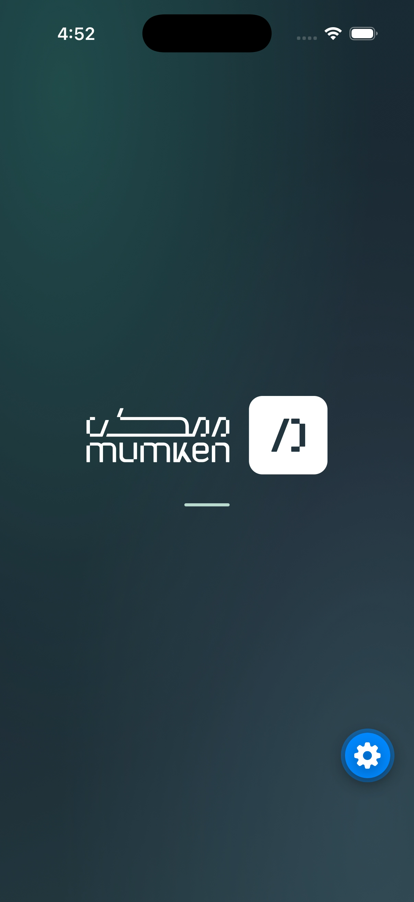

## 2. Browse the updates

Start the app and use the language button. Titles, summaries, labels, dates, and layout direction switch between English/LTR and Arabic/RTL. Open an update to reach its discussion.

| English | العربية |
| --- | --- |
| 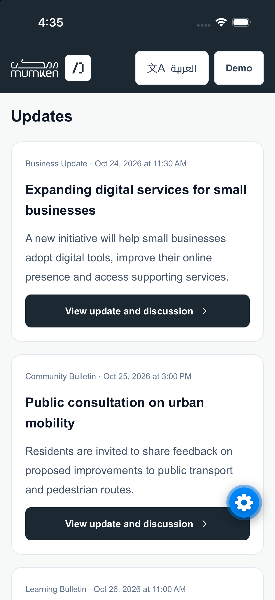 | 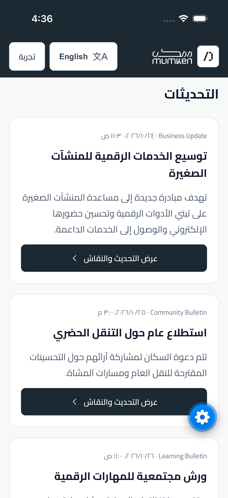 |

## 3. Open an empty discussion and reject empty input

Choose **Empty discussion / نقاش فارغ** and press Post comment without entering text. The record remains readable, the form shows validation feedback, and the empty-discussion message invites the first contribution.

| English | العربية |
| --- | --- |
| 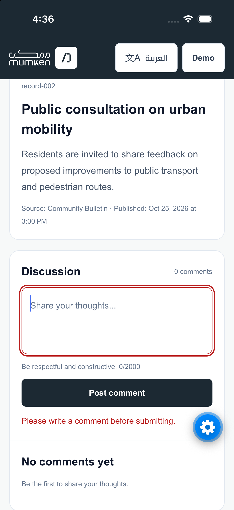 | 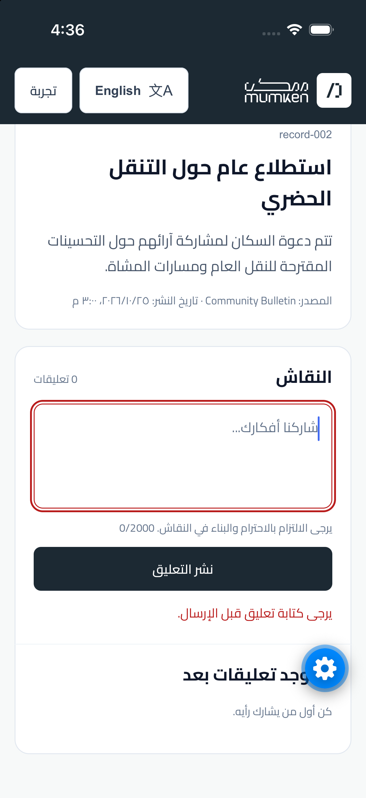 |

## 4. Preserve a failed reply and its target

Choose **Next submission fails / فشل الإرسال التالي**, open the first update, and select Reply on Lina Haddad's comment. Enter text and submit. The failure retains both the draft and the selected author. Switching the interface language preserves the draft; the same English text is shown in both captures.

| English | العربية |
| --- | --- |
| 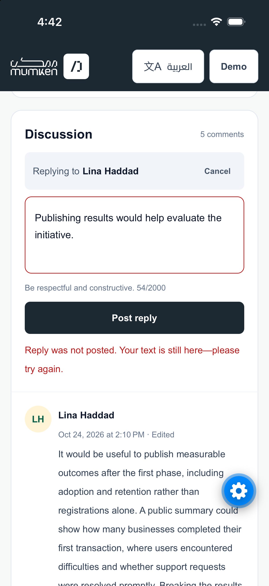 | 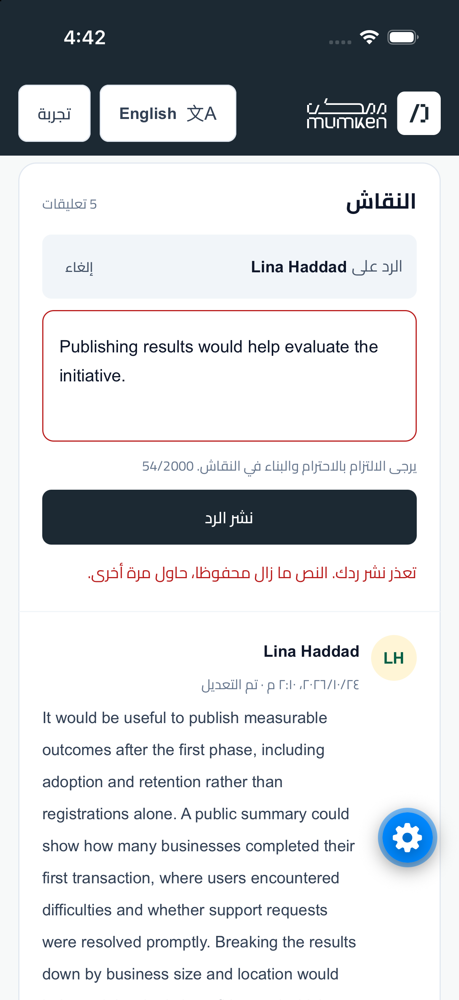 |

## 5. Retry and confirm success

Retry the saved reply. The submission succeeds, the composer clears, a green confirmation appears, and the discussion count increases from five to six. The selected reply target is cleared. The paired screenshots show the same successful session in both languages; the reply remains under its parent further down the thread.

| English | العربية |
| --- | --- |
| 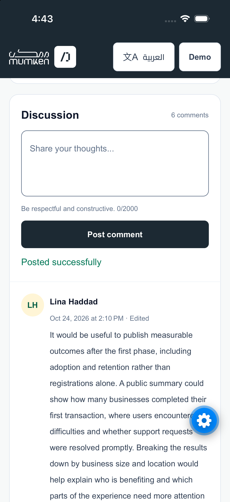 | 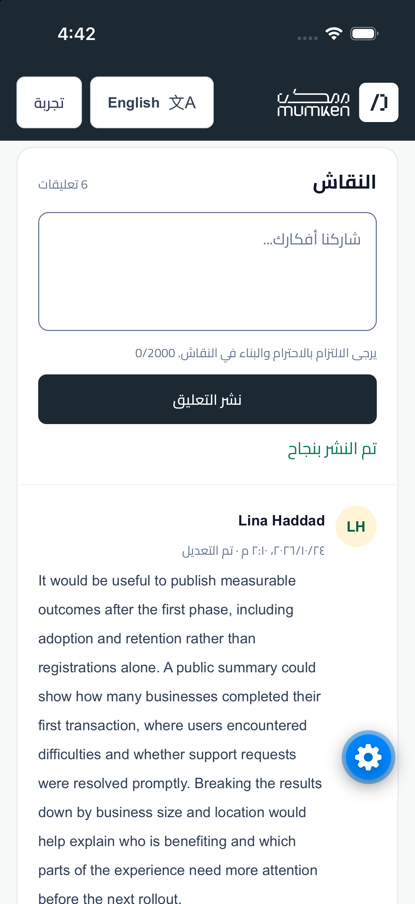 |

## 6. Recover from a loading error

Choose **Initial load failure / فشل التحميل الأولي**. A localized message and Try again action replace the loading state. Retry was exercised and returned to the updates list. The error is shown in both languages rather than repeating the recovered list screenshots.

| English | العربية |
| --- | --- |
| 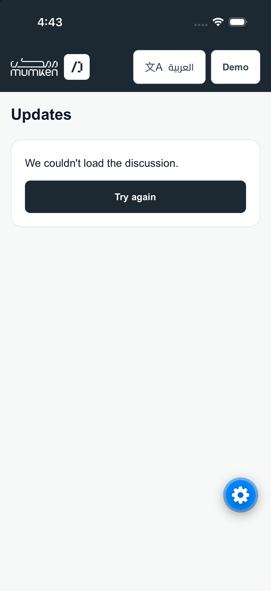 | 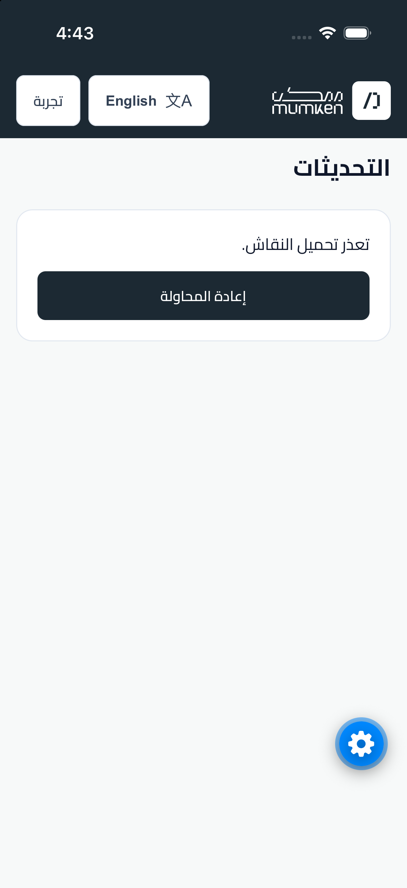 |

## 7. Handle an unavailable update

Choose **Unavailable record / تحديث غير متاح**. A localized explanation appears without a composer, and All updates returns to the list.

| English | العربية |
| --- | --- |
| 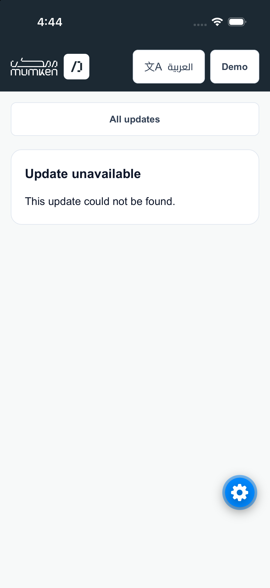 | 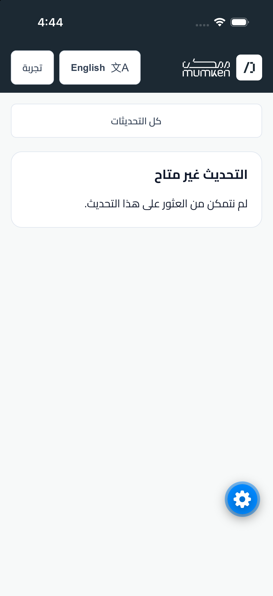 |

## Review and automated checks

The native walkthrough exercised language switching, opening records, rejecting empty submissions, reply selection, failed-reply draft preservation, retry, success feedback, initial-load recovery, and missing-record navigation. The screenshots document stable outcomes rather than every animation frame.

Startup behavior and device-storage rules are documented in the main README. This pass does not claim a device reboot test, physical-device validation, or complete VoiceOver/software-keyboard coverage. Those remain separate checks; the native screenshots are evidence of the simulator journey only.

On November 2, 2026, the following checks passed:

| Check | Result |
| --- | --- |
| `npm test` | 8 tests passed; repository and model behaviors. |
| `npm run lint` | Passed. |
| `npm run typecheck` | Passed. |

Automated tests cover seed data and thread ordering, session isolation, text and reply-target validation, one-time failures and recovery, production demo isolation, and localized date formatting. They do not render or drive the native UI; the simulator walkthrough above was performed separately.
